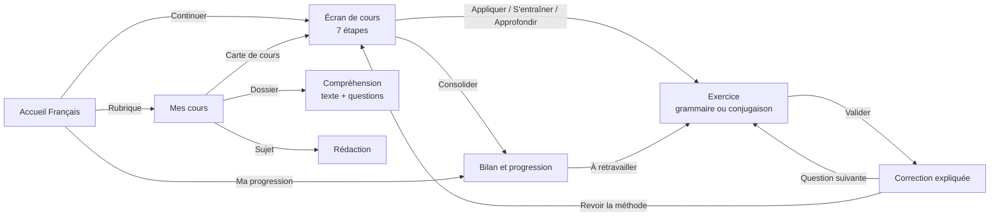

<!-- Issue #231 — Refonte professionnelle de l'interface Français : audit, design system, maquettes (Claude) -->
# Refonte de l'interface Français : audit, maquettes et plan de livraison

Issue #231 (sous-ticket de #175), renforcée par le propriétaire le 27/11/2026. Rédigé par Claude (Claude Code), 27/11/2026.

**Statut au 27/11/2026, fin de journée** : le propriétaire a délégué les arbitrages D1 à D6 (appliqués, voir
`DECISIONS.md`, FR-UI-D1 à D6) et demandé de commencer par l'administration. **Livré : la page « Boussole
Français » de l'administration** (§ 8, PR 4a) **et l'espace professeur Français** (PR 4b), captures réelles dans
[`apres/`](apres/). Les autres écrans suivent
le découpage du § 8.

Statut initial : maquettes à valider. Ce dossier ne modifie ni le
code, ni les contenus, ni les règles de maîtrise, de sécurité, d'habilitation ou de validation pédagogique.
`PKP_REDACTION_ACTIVE` et `PKP_PDF_FRANCAIS_OUVERT` restent faux.

| Livrable demandé | Où le trouver |
|---|---|
| Audit des écrans existants avec captures | § 2 et § 3 ; captures dans [`audit/`](audit/) |
| Comparaison avant / après | § 4 ; écran « Avant / après » du prototype |
| Proposition de design system commun | § 5 |
| Maquettes haute fidélité (13 écrans) | [`maquettes/`](maquettes/) : 13 versions ordinateur, 11 versions mobile |
| Prototype de navigation | [`prototype.html`](prototype.html), à ouvrir dans un navigateur ; § 6 |
| Découpage des PR | § 8 |
| Critères de recette graphique et fonctionnelle | § 9 |
| Points à trancher | § 7 |

Le prototype et les maquettes utilisent les **huit cours réels de #177** (énoncés, corrigés, leçons et texte tirés de
`contenu/francais/` et du dossier `FR3-DNB27-01`) et des **utilisateurs fictifs** : élèves `Lina4` (5e B), `Noah2`
(3e A), professeures « Mme Martin » et « Mme Leroy ». Aucun nom de famille d'enfant (RGPD-1).

---

## 1. Ce qui change, en une page

| Aujourd'hui | Proposé |
|---|---|
| L'élève de français arrive sur une barre de **8 onglets** (9 avec le diagnostic), tronquée à 1 366 px | **Trois destinations** : Accueil, Mes cours, Ma progression. Le reste (historique, fiches, remarques) passe dans « Plus » |
| Aucune page d'accueil de la matière | **Accueil Français** : reprise du cours en un clic, quatre rubriques, travail à faire, retours et ressources de la professeure |
| Dossiers et chapitres dans deux blocs de liens différents | **Une seule carte de cours** pour les chapitres et les dossiers (décision A1 : la différence technique est masquée) |
| Leçon, exercices et correction dans des onglets séparés | **Écran de cours** organisé en **sept étapes** (#177) : Découvrir, Comprendre, Appliquer, S'entraîner, Approfondir, Réinvestir, Consolider |
| Texte du dossier en liste, sous la leçon, à 5 900 px des questions | **Texte et questions côte à côte**, lignes numérotées en marge ; bascule « Le texte / Questions » sur mobile |
| Professeure de français accueillie par « Boussole Maths » | **Espace professeur Français** : tableau de bord de la classe, présentation (#111), validation, rédactions |
| Validation dans un tableau de 14 000 px | **File de validation** : liste à gauche, aperçu élève et corrigé séparés à droite |
| Parent : « Le français arrive bientôt » | **Bilan Français** de l'enfant, sans aucun texte rédigé (RGPD-2, SEC-D6) |

Le design reste celui de la charte #149 (« instrument de précision » : cadre sombre, travail clair). Il ajoute une
police de lecture pour les textes longs et quelques composants propres au français, réutilisables par les autres
matières.

---

## 2. Méthode de l'audit

- **Version auditée** : `develop` au commit `da93c37` (27/11/2026, après la PR #239).
- **Pile locale jetable**, autorisée aux agents (AGENTS.md § 1) : base SQLite temporaire, migrations, données de
  démonstration, import du contenu (12 chapitres de français, dossier `FR3-DNB27-01`), API sur le port 8765, front
  Vite sur le port 5765. `api/pkp.db` n'a pas été touchée ; aucune instance partagée n'a été utilisée.
- **Données fictives** créées par [`outils/captures-audit.mjs`](outils/captures-audit.mjs), qui refuse toute
  adresse non locale : professeure de 3e, validatrice (4e et 3e), classe pilote de 3e avec trois élèves, dossier
  validé et ouvert, chapitres de 3e proposés, parent rattaché. Dans cette base jetable seulement, les questions de 3e
  ont été marquées validées pour que l'élève voie des exercices ; celles de 6e à 4e restent « à valider ».
- **Tailles** : ordinateur 1 366 × 900, tablette 820 × 1 180, mobile 390 × 844 ; captures pleine page.
- **Limites** : pas de mesure automatique d'accessibilité (axe) ni de lecteur d'écran ; elles relèvent de la PR 5
  et des contrôles de #154. Le circuit « famille » (enfant inscrit par carte) n'a pas été capturé : le parent de
  l'audit est rattaché à un élève de classe.

---

## 3. Audit des écrans existants

### 3.1 Constats U1 à U7 de l'issue, vérifiés à l'écran

| # | Constat de l'issue | Résultat | Preuve |
|---|---|---|---|
| U1 | Jusqu'à 9 onglets en Français, pas d'accueil de matière | **Confirmé, aggravé** : 8 onglets ; à 1 366 px le dernier (« Remarques ») est coupé (« Rer ») sans indication de défilement ; sur mobile, 4 lignes d'onglets avant le contenu | [`eleve-ordinateur-cours`](audit/eleve-ordinateur-cours.png), [`eleve-mobile-cours`](audit/eleve-mobile-cours.png) |
| U2 | « S'entraîner » vide en Français | **Corrigé en partie** : les chapitres ouverts y apparaissent, mais la note affichée au-dessus dit encore que tout se trouve dans « Cours » : message contradictoire (voir N7) | [`eleve-ordinateur-s-entrai-ner`](audit/eleve-ordinateur-s-entrai-ner.png) |
| U3 | Les quatre rubriques ne sont pas présentées comme des entrées | **Confirmé** : « Cours » liste les chapitres par titre, sans rubrique ; la rédaction apparaît comme un chapitre parmi d'autres | [`eleve-ordinateur-cours`](audit/eleve-ordinateur-cours.png) |
| U4 | Dossiers et chapitres dans des écrans différents | **Confirmé** : deux blocs (« Mes dossiers », « Cours ») de présentation différente sur le même onglet, plus « Rédaction » et « Mon cours » dans leurs onglets | idem |
| U5 | Présentations de #111 non implémentées | **Confirmé** : aucune trace à l'écran | — |
| U6 | Parent : « Le français arrive bientôt » | **Confirmé dans le code** (`EspaceParent.jsx`, vue « francais » du circuit famille). Le circuit capturé (parent d'un élève de classe) montre un tableau générique libellé « Troisième — Tronc commun », sans dossier, quiz ni rubrique (N8) | [`parent-ordinateur`](audit/parent-ordinateur.png), [`parent-mobile`](audit/parent-mobile.png) |
| U7 | Adultes : cohérence avec Maths et Anglais à évaluer | **Écarts confirmés** : voir N4 à N6 | [`professeur-ordinateur-accueil`](audit/professeur-ordinateur-accueil.png), [`professeur-ordinateur-francais-dossiers`](audit/professeur-ordinateur-francais-dossiers.png) |

### 3.2 Constats nouveaux

| # | Gravité | Constat | Preuve |
|---|---|---|---|
| N1 | Moyenne | La barre d'onglets défile horizontalement sans indice visuel ; un élève ne voit pas « Remarques » | [`eleve-ordinateur-ma-progression`](audit/eleve-ordinateur-ma-progression.png) |
| **N2** | **Haute** | Un dossier **validé et ouvert** montre à l'élève des mentions internes : « Issue #55 — rédaction originale par Codex, 14/11/2026 » et « Brouillon à relire par un professeur avant utilisation ; dossier préparatoire non publié sur le site ». Elles viennent du champ `eleve.presentation` du dossier. Effet : perte de crédibilité, information contradictoire | [`eleve-ordinateur-dossier-ouvert-haut`](audit/eleve-ordinateur-dossier-ouvert-haut.png) |
| N3 | Haute | Le texte du dossier est une liste numérotée placée sous la leçon ; les questions viennent ensuite. Page de 5 973 px : l'élève fait défiler entre texte et question pour citer une ligne | [`eleve-ordinateur-dossier-ouvert`](audit/eleve-ordinateur-dossier-ouvert-haut.png) (extrait) |
| N4 | Moyenne | Une professeure **de français** est accueillie par la marque « Boussole Maths » ; le lien vers le Français est relégué en bas de la barre latérale ; « Créer une classe » propose « Seconde » par défaut | [`professeur-ordinateur-accueil`](audit/professeur-ordinateur-accueil.png) |
| N5 | Moyenne | L'espace `/francais` est un second espace adulte avec une seule entrée de navigation (« Dossiers et validation ») ; on y revient par un lien, sans retour symétrique vers l'espace professeur | [`professeur-ordinateur-francais-dossiers`](audit/professeur-ordinateur-francais-dossiers.png), [`validateur-ordinateur-francais-validation`](audit/validateur-ordinateur-francais-validation.png) |
| N6 | Haute (validateur) | La validation des questions est un tableau de 38 lignes (environ 14 400 px) : énoncé, métadonnées et solution dans des colonnes étroites ; aucun aperçu de la question telle que l'élève la verra | [`validateur-ordinateur-validation-questions-haut`](audit/validateur-ordinateur-validation-questions-haut.png) |
| N7 | Basse | « S'entraîner » : note qui renvoie vers « Cours » au-dessus d'un entraînement qui fonctionne ; la rédaction y figure, grisée, « bientôt disponible » | [`eleve-ordinateur-s-entrai-ner`](audit/eleve-ordinateur-s-entrai-ner.png) |
| N8 | Moyenne | Le parent d'un élève de classe voit le tableau des maths (« Troisième — Tronc commun », compétences, activité) appliqué au français, sans quiz de dossier ni retours | [`parent-ordinateur`](audit/parent-ordinateur.png) |
| N9 | Basse | « Ma progression » ne montre pas les dossiers (quiz, « Je sais ») : la compréhension de texte n'apparaît pas dans le bilan de l'élève | [`eleve-ordinateur-ma-progression`](audit/eleve-ordinateur-ma-progression.png) |
| N10 | Basse | En capture pleine page, le pied de page élève et la barre latérale adulte s'arrêtent avant le bas de la page (bande claire). À vérifier en navigation réelle | [`administrateur-ordinateur-accueil`](audit/administrateur-ordinateur-accueil.png) |

Points positifs à conserver : contraste des textes, focus visible et charte sombre/claire de #149 ; corrigés absents
côté élève avant réponse (vérifié par la recette #217) ; entraînement adaptatif des chapitres fonctionnel ; la
référence Maths ([`reference-maths-eleve-ordinateur`](audit/reference-maths-eleve-ordinateur.png)) reste cohérente.

### 3.3 Inventaire des captures

27 captures dans [`audit/`](audit/) : élève (7 onglets sur ordinateur, 3 sur tablette, 3 sur mobile, dossier
ouvert), parent (ordinateur, mobile), professeur (ordinateur et mobile : accueil, dossiers, cours, suivi),
validateur (deux files), administrateur (tableau de bord, Français), référence Maths. Les deux captures très longues
sont recadrées sur leur partie haute (`-haut`).

---

## 4. Comparaison avant / après

| Écran | Avant (capture) | Après (maquette) |
|---|---|---|
| Arrivée de l'élève | [`eleve-ordinateur-cours`](audit/eleve-ordinateur-cours.png) | [`01-accueil-ordinateur`](maquettes/01-accueil-ordinateur.png), [`01-accueil-mobile`](maquettes/01-accueil-mobile.png) |
| Liste des cours | [`eleve-mobile-cours`](audit/eleve-mobile-cours.png) | [`02-catalogue-ordinateur`](maquettes/02-catalogue-ordinateur.png), [`02-catalogue-mobile`](maquettes/02-catalogue-mobile.png) |
| Leçon | [`eleve-ordinateur-dossier-ouvert-haut`](audit/eleve-ordinateur-dossier-ouvert-haut.png) | [`03-lecon-ordinateur`](maquettes/03-lecon-ordinateur.png), [`03-lecon-mobile`](maquettes/03-lecon-mobile.png) |
| Entraînement | [`eleve-ordinateur-s-entrai-ner`](audit/eleve-ordinateur-s-entrai-ner.png) | [`04-grammaire`](maquettes/04-grammaire-ordinateur.png), [`05-conjugaison`](maquettes/05-conjugaison-ordinateur.png), [`07-correction`](maquettes/07-correction-ordinateur.png) |
| Compréhension | [`eleve-ordinateur-dossier-ouvert-haut`](audit/eleve-ordinateur-dossier-ouvert-haut.png) | [`06-comprehension-ordinateur`](maquettes/06-comprehension-ordinateur.png), [`06-comprehension-mobile`](maquettes/06-comprehension-mobile.png) |
| Progression | [`eleve-ordinateur-ma-progression`](audit/eleve-ordinateur-ma-progression.png) | [`08-bilan-ordinateur`](maquettes/08-bilan-ordinateur.png), [`08-bilan-mobile`](maquettes/08-bilan-mobile.png) |
| Rédaction | [`eleve-ordinateur-re-daction`](audit/eleve-ordinateur-re-daction.png) | [`09-redaction-ordinateur`](maquettes/09-redaction-ordinateur.png), [`09-redaction-mobile`](maquettes/09-redaction-mobile.png) |
| Professeur | [`professeur-ordinateur-accueil`](audit/professeur-ordinateur-accueil.png), [`professeur-ordinateur-francais-suivi-des-classes`](audit/professeur-ordinateur-francais-suivi-des-classes.png) | [`10-professeur-ordinateur`](maquettes/10-professeur-ordinateur.png), [`10-professeur-mobile`](maquettes/10-professeur-mobile.png) |
| Validateur | [`validateur-ordinateur-validation-questions-haut`](audit/validateur-ordinateur-validation-questions-haut.png) | [`11-validateur-ordinateur`](maquettes/11-validateur-ordinateur.png) |
| Administrateur | [`administrateur-ordinateur-francais`](audit/administrateur-ordinateur-francais.png) | [`12-administrateur-ordinateur`](maquettes/12-administrateur-ordinateur.png) |
| Parent | [`parent-ordinateur`](audit/parent-ordinateur.png), [`parent-mobile`](audit/parent-mobile.png) | [`13-parent-ordinateur`](maquettes/13-parent-ordinateur.png), [`13-parent-mobile`](maquettes/13-parent-mobile.png) |

Les « après » sont des maquettes : les captures « après » réelles seront faites avec le même script à la fin de
chaque PR (critère de clôture de #231).

---

## 5. Design system commun proposé

### 5.1 Principes

1. **Une question par écran** : l'accueil répond à « que faire maintenant ? », une activité à « que dois-je
   répondre ? ».
2. **Le texte d'abord** : en français, le texte est l'objet de travail. Colonne de lecture limitée, police de
   lecture, numéros de ligne en marge.
3. **Sobriété** : pas de points, de séries, de badges ni d'animations de récompense. La progression s'exprime en
   compétences et en étapes.
4. **L'état réel est affiché** : une fonction fermée (rédaction en ligne, PDF) est montrée fermée, avec sa raison,
   jamais cachée ni simulée.
5. **Rien n'est porté par la seule couleur** : chaque état a un libellé et, si possible, une icône.

### 5.2 Jetons

Tous les jetons de [`web/src/theme.css`](../../../web/src/theme.css) sont conservés. Ajouts proposés, avec leurs
valeurs pour le mode sombre :

| Jeton | Clair | Sombre | Usage |
|---|---|---|---|
| `--fr-doux` | `#e3f2f0` | `#15302d` | Fond des pastilles et puces de rubrique, étape active |
| `--fr-fort` | `#0a524c` | `#8fe3d8` | Texte sur `--fr-doux`, filtre actif |
| `--fr-trait` | `#b9ddd8` | `#2a5a54` | Bordure de la carte de reprise, repère de lignes |
| `--papier` | `#fffdf8` | `#1d1f27` | Fond des textes à lire et des phrases d'exercice |
| `--police-lecture` | Literata | — | Textes, phrases d'exercice, consignes de rédaction |

`--francais` (`#0f6e66`) reste la couleur de la matière. Contrastes à mesurer dans la PR 2 (objectif ≥ 4,5:1 pour
le texte, ≥ 3:1 pour les éléments non textuels, #154).

### 5.3 Typographie

| Rôle | Police | Taille / interligne |
|---|---|---|
| Titres | Space Grotesk (existante) | 32 / 24 / 20 / 17 px |
| Interface | Inter (existante) | 15–16 px / 1,5 |
| **Lecture** (nouvelle, D4) | **Literata**, OFL 1.1, auto-hébergée comme les deux autres (`@fontsource`) | 18 px / 1,7 ; colonne de 66 caractères au plus |
| Phrase d'exercice | Literata | 24 px (ordinateur), 19 px (mobile) |
| Numéros de ligne, codes | Police mono du système | 12–13 px |

### 5.4 Composants

Les composants marqués « commun » servent aussi aux Maths et à l'Anglais.

| Composant | Rôle | Part de l'existant | Portée |
|---|---|---|---|
| `NavigationMatiere` | Barre haute (ordinateur) et barre basse (mobile) : Accueil, Mes cours, Ma progression, Plus | remplace `Onglets` pour le français ; `Onglets` reste pour les autres matières en attendant D5 | commun |
| `CarteReprise` | Reprendre le dernier cours à la bonne étape | données de `Progression` et de l'historique | commun |
| `CarteRubrique` | Entrée d'une rubrique avec état | nouveau | français |
| `CarteCours` | Chapitre ou dossier, même gabarit, état et étapes | fusion de l'affichage de `Cours.jsx` et `DossiersFrancais.jsx` | commun |
| `Etapes` | Rail des 7 étapes (ordinateur), barre et pastille (mobile) | nouveau | commun |
| `ZoneLecture`, `Encadre` (règle, méthode, erreur) | Leçon en colonne de lecture | rendu Markdown de `Cours.jsx`, `Pedagogie.jsx` | commun |
| `PhraseCible` | Phrase d'exercice avec groupe souligné | nouveau, au-dessus d'`Exercice.jsx` | français |
| `ChoixQCM` | Grandes cibles lettre + libellé, états juste/faux libellés | restyle d'`Exercice.jsx` | commun |
| `SaisieCourte` + `ClavierAccents` | Réponse `texte` avec lettres accentuées | type `texte` existant | commun |
| `CorrectionExpliquee` | Verdict, méthode, étapes, erreur fréquente, retour à la leçon | champ `correction`, `ResultatReponse` | commun |
| `TexteNumerote` | Texte d'un dossier, lignes numérotées en marge, plage repérée | données `textes[].lignes` du dossier | français |
| `PanneauAide` | Marge d'aides : objectifs, essentiel, erreurs, ressources | champs `objectifs`, `resume`, `erreurs_frequentes`, `MonCours` | commun |
| `EtatFerme` | Fonction désactivée et sa raison | nouveau | commun |
| `Pastille`, `Jauge`, `Chiffre`, `Niveau` | États, progression, indicateurs | classes existantes de `styles.css` | commun |
| `TableauSuivi` | Élèves × cours avec niveaux libellés | `SuiviFrancais.jsx` | commun |
| `FileValidation` + `ApercuEleve` + `Corrige` | Validation question par question | `Validation.jsx`, routes de validation existantes | commun |

### 5.5 Règles d'accessibilité intégrées dès la PR 2

Cibles d'au moins 44 × 44 px ; navigation entière au clavier, focus visible ; lecture à 200 % sans perte ni
défilement horizontal ; `prefers-reduced-motion` respecté ; étapes exposées avec `aria-current="step"` ; texte
numéroté lisible par un lecteur d'écran (le numéro est un contenu, pas une décoration) ; une fonction fermée est
annoncée comme telle.

---

## 6. Prototype de navigation

[`prototype.html`](prototype.html) s'ouvre dans un navigateur, sans installation. Le sommaire donne les 13 écrans
et l'écran « Avant / après » ; un bouton passe de la version ordinateur à la version mobile ; sous chaque maquette,
trois notes donnent l'intention, les composants réutilisés et les garde-fous. Les boutons des maquettes mènent aux
écrans suivants du parcours. Le prototype charge les polices depuis Google Fonts ; l'application les servira
elle-même (CSP `font-src 'self'`).



Le parcours « accueil → rubrique → leçon → entraînement → correction → progression » de #175 § 5 se fait en
cinq actions au plus.

---

## 7. Points à trancher par le propriétaire

Ces points relèvent d'une décision du propriétaire (AGENTS.md § 0 et § 8). Les maquettes appliquent la
recommandation ; elles s'adaptent sans difficulté à l'autre option.

| # | Question | Options | Recommandation |
|---|---|---|---|
| **D1** | **Quatre rubriques affichées à l'élève.** La demande cite lecture, grammaire, conjugaison et rédaction ; la décision A1 et le modèle (`RubriqueFrancais`) disent conjugaison, grammaire, rédaction et « Mon cours » | **A.** Afficher « Lire et comprendre » (les dossiers), Grammaire, Conjugaison, Rédaction ; « Mon cours » devient « Ressources de ta professeure », visible dans l'accueil et chaque cours. Aucune migration : seul l'affichage change. **B.** Garder les quatre rubriques de A1 et ajouter « Comprendre un texte » en cinquième entrée (maquettes du 26/11) | **A** : c'est la lecture pédagogique de la demande, et « Mon cours » est une ressource, pas une activité. Nécessite de **compléter la décision A1** dans `DECISIONS.md` |
| **D2** | **Sept étapes (#177) et cinq étapes du parcours guidé (#111** : Je comprends, Je mémorise, Je m'entraîne, Je me dépasse, Je vérifie) | **A.** Les sept étapes deviennent le parcours guidé ; correspondance : Comprendre ↔ Je comprends, Consolider ↔ Je mémorise et Je vérifie, Appliquer et S'entraîner ↔ Je m'entraîne, Approfondir et Réinvestir ↔ Je me dépasse. **B.** Afficher les cinq étapes de #111 et regrouper les sept | **A**, cohérent avec les contenus produits et le GO du 27/11 |
| **D3** | **Étapes 3 à 5 par difficulté.** Le moteur choisit la question suivante selon la maîtrise ; il ne sert pas « une question de difficulté 1 » sur demande | **A.** Affichage seulement : le moteur choisit, l'écran indique l'étape d'après la difficulté de la question servie et compte les étapes faites ; aucune modification du moteur ni de l'API d'exercice. **B.** Filtre de difficulté demandé à l'API d'exercice (le moteur reste inchangé, mais l'ordre change) | **A** pour le pilote : aucune règle de maîtrise n'est touchée. B à réexaminer après retour des professeurs |
| D4 | **Police de lecture** | Ajouter Literata (OFL 1.1, sous-ensemble latin auto-hébergé, poids à mesurer dans la PR 2) ou garder Inter partout | Ajouter Literata, pour les textes longs seulement |
| D5 | **Navigation à trois destinations** | Pour le français seulement (PR 2), ou pour les trois matières | Français d'abord ; Maths et Anglais gardent leurs onglets (aucune régression) ; harmonisation décidée après le pilote |
| D6 | **N2 (mentions internes visibles par l'élève)** | Correctif immédiat et isolé (PR 0), ou dans la PR 3 | PR 0 immédiate : trois lignes de contenu ou un filtre d'affichage, sans attendre la refonte |

---

## 8. Découpage des PR

Le découpage en cinq PR validé le 26/11 est conservé ; la PR 3 est scindée pour rester relisible, et une PR 0
corrige tout de suite le constat N2. Chaque PR part de `develop`, est ouverte en brouillon et se termine par les
captures « après » faites avec [`outils/captures-audit.mjs`](outils/captures-audit.mjs).

| PR | Objet | Fichiers principaux | Tests et recette | Dépend de |
|---|---|---|---|---|
| **0** | Ne plus montrer à l'élève les mentions internes d'un dossier (N2) ; texte de la note de « S'entraîner » (N7) | `DossiersFrancais.jsx` ou `eleve.presentation` du dossier, `EspaceEleve.jsx` | Vitest : la mention n'est pas rendue ; recette #217 verte | D6 |
| **1** | **Parent** : bilan Français (cours ouverts, maîtrise, quiz, temps, retours reçus), sans texte rédigé | `EspaceParent.jsx`, résumé de `routes/familles.py` (lecture seule) | Vitest ; test API : aucun texte d'élève dans la réponse (RGPD-2) ; captures parent | Maquette 13 |
| **2** | **Fondations et accueil élève** : jetons et police (D4), `NavigationMatiere`, `CarteReprise`, `CarteRubrique`, `CarteCours` ; accueil et catalogue | `theme.css`, `styles.css`, nouveaux composants `web/src/ui/`, `EspaceEleve.jsx` (branche français) | Vitest ; onglets Maths et Anglais inchangés (test) ; recette navigateur : accueil → rubrique → cours | D1, D5 |
| **3a** | **Écran de cours en sept étapes** : rail, leçon, exercices de grammaire et de conjugaison, correction expliquée, bilan | `Cours.jsx`, `Exercice.jsx` (présentation), `Etapes`, `ZoneLecture`, `CorrectionExpliquee` | Vitest ; aucune solution dans le DOM avant réponse (ARCH-4) ; recette : leçon → exercice → correction → bilan | D2, D3, PR 2 |
| **3b** | **Compréhension et rédaction** : `TexteNumerote`, texte et questions côte à côte, rédaction avec état fermé | `DossiersFrancais.jsx`, `Redaction.jsx` | Vitest ; drapeaux inchangés ; recette : dossier ouvert, quiz, état fermé | PR 3a |
| **4a ✔** | **Administration** (fait le 27/11) : page « Boussole Français » : « À traiter » (alertes avec l'écran qui les règle), cours prêts, questions validées, classes pilotes, tableau par niveau (validateurs, classes pilotes), chapitres et dossiers ensemble par niveau et rubrique, fonctions sensibles en lecture seule. Remplace le lien « Boussole Français (préparation) » | `api/app/routes/admin_francais.py` (`GET /admin/francais/synthese`, lecture seule), `web/src/admin/FrancaisAdmin.jsx`, `EspaceAdmin.jsx`, `Exercices.jsx` (filtre `?statut=`), `styles.css` | 5 tests API, 4 tests Vitest, navigation mise à jour, recette #217 adaptée | — |
| **4b ✔** | **Professeur** (fait le 27/11) : marque « Boussole Français » ; navigation en groupes « Français » et « Outils » ; pages propres aux maths retirées pour un professeur de français seul ; **tableau de bord** de la classe : indicateurs, à faire (questions à valider dans son périmètre, élèves à accompagner, rédactions), présentation de #111 (parcours guidé, origine « par défaut »), suivi élèves × cours (chapitres et dossiers) ; création de classe en 6e par défaut | `api/app/routes/francais_tableau.py` (`GET /francais/classes/{id}/tableau`, lecture seule), `web/src/francais/TableauFrancais.jsx`, `EspaceEnseignant.jsx`, `Classes.jsx`, `styles.css` | 4 tests API, 6 tests Vitest | — |
| **4** | **Adultes (reste)** : file de validation en deux volets (aperçu élève, corrigé), espace professeur Français (marque, tableau de bord, présentation de #111 en lecture), file de validation, page Français de l'administration | `EspaceEnseignant`, `SuiviFrancais.jsx`, `Validation.jsx`, `EspaceFrancais.jsx`, `admin/` | Vitest ; refus d'auto-validation inchangé (test API existant) ; recette validateur et administrateur | Maquettes 10–12 |
| **5** | **Passe finale responsive et accessibilité** (#154) : 3 tailles, clavier, zoom 200 %, contraste, lecteur d'écran sur les parcours clés | tous les écrans modifiés | axe sur les écrans clés ; captures avant/après des cinq rôles | PR 1 à 4 |

La persistance des présentations par groupe ou séance (#111) reste suspendue à l'arbitrage EX.4 ; la PR 4 affiche
le réglage et son origine sans l'enregistrer.

---

## 9. Critères de recette

### 9.1 Graphiques

| Code | Critère |
|---|---|
| G-01 | Les écrans livrés correspondent aux maquettes validées (écarts listés et acceptés dans la PR) |
| G-02 | Seuls les jetons du design system sont utilisés : aucune couleur ni taille écrite en dur dans les composants |
| G-03 | Colonne de lecture ≤ 66 caractères ; texte de lecture à 18 px (ordinateur) et 17 px au moins (mobile) |
| G-04 | Aucun défilement horizontal de la page à 390, 820 et 1 366 px ; les tableaux larges défilent dans leur cadre |
| G-05 | Mêmes gabarits pour les chapitres et les dossiers (carte, en-tête, étapes) |
| G-06 | Mode sombre lisible sur tous les écrans modifiés |
| G-07 | Aucune gamification ajoutée (points, séries, badges, confettis) |
| G-08 | Les fonctions fermées sont affichées fermées, avec leur raison |

### 9.2 Fonctionnels

| Code | Critère |
|---|---|
| F-01 | Un élève pilote atteint son cours en cours depuis l'accueil en un clic (« Continuer ») |
| F-02 | Parcours accueil → rubrique → leçon → entraînement → correction → progression sans aide, testé avec au moins un élève et un professeur (#175 § 5) |
| F-03 | Aucune solution ni explication dans la page avant la réponse (ARCH-4), vérifié par la recette navigateur |
| F-04 | Seuls les cours validés et ouverts à la classe apparaissent (V2-D15, SEC-D6) ; un élève hors pilote ne voit rien |
| F-05 | La correction humaine n'entre dans aucun pourcentage de maîtrise (ARCH-5) |
| F-06 | `PKP_REDACTION_ACTIVE` et `PKP_PDF_FRANCAIS_OUVERT` restent faux ; l'interface ne permet pas de les changer |
| F-07 | Parent : aucun texte rédigé par l'enfant n'est transmis par l'API ni affiché (RGPD-2) |
| F-08 | Professeur : le réglage de présentation affiche « Parcours guidé », origine « Par défaut » (FR-01 de #111) |
| F-09 | Validateur : impossible de valider son propre contenu ; « À corriger » exige un motif ; décision journalisée |
| F-10 | Non-régression : tests Maths et Anglais verts ; captures Maths et Anglais identiques avant et après |

### 9.3 Accessibilité (#154)

| Code | Critère |
|---|---|
| A-01 | Tous les parcours au clavier, focus visible, ordre logique |
| A-02 | Contraste ≥ 4,5:1 (texte) et ≥ 3:1 (éléments d'interface), mesuré |
| A-03 | Zoom 200 % sans perte d'information |
| A-04 | Étapes, onglets et états annoncés par un lecteur d'écran (`aria-current`, rôles, libellés) |
| A-05 | Cibles tactiles ≥ 44 × 44 px sur mobile |
| A-06 | `prefers-reduced-motion` respecté |

---

## 10. Reproduire

Préparer la pile locale (base jetable, jamais `api/pkp.db`), depuis la racine du dépôt :

```bash
export PKP_DATABASE_URL="sqlite:///$(mktemp -d)/audit.db"
(cd api && ../.venv/bin/python -m alembic upgrade head && ../.venv/bin/python -m app.db.seed && ../.venv/bin/python -m app.contenu importer)
(cd api && ../.venv/bin/python -m uvicorn app.main:app --host 127.0.0.1 --port 8765) &
(cd web && PKP_API_URL=http://127.0.0.1:8765 ./node_modules/.bin/vite --host 127.0.0.1 --port 5765 --strictPort) &
```

Puis les captures et le rendu des maquettes :

```bash
node docs/francais/refonte-231/outils/captures-audit.mjs docs/francais/refonte-231/audit
node docs/francais/refonte-231/outils/rendu-maquettes.mjs "$PWD/docs/francais/refonte-231/prototype.html" docs/francais/refonte-231/maquettes
```

Pour voir des exercices côté élève, les questions de la classe auditée doivent être validées **dans la base
jetable** ; sur une instance partagée, la validation est une décision pédagogique humaine.

---

<sub>🤖 Produit par **Claude** (Claude Code), 27/11/2026, issue #231. Maquettes à valider par le propriétaire ;
aucune modification du code applicatif.</sub>
